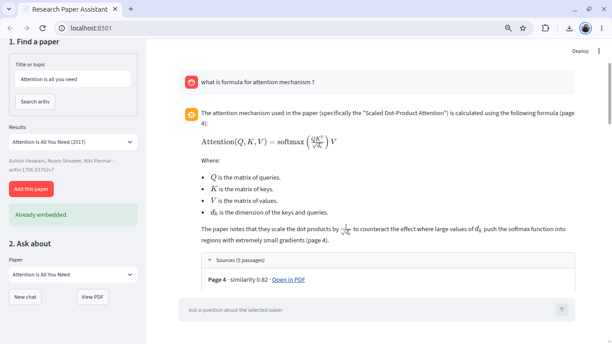
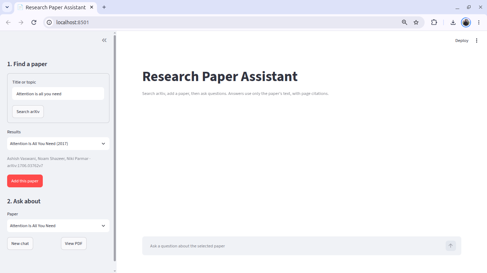
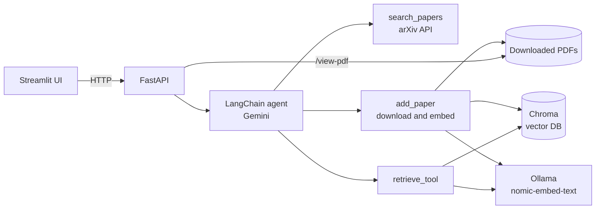

# Research Paper Assistant

Chat with any arXiv paper. Search arXiv, pick the exact paper, and ask questions. Answers come only from the paper's own text, with page citations and one-click links to the cited page in the PDF.



## Features

- **You choose the paper.** The agent searches arXiv and lists candidates; it never guesses which one you meant. This avoids look-alike titles such as *Not All Attention Is All You Need*.
- **Download and embed once.** Only the chosen paper is downloaded and embedded. Adding it again is a no-op because every chunk has a deterministic ID.
- **Grounded answers with citations.** The agent answers only from retrieved passages, cites page numbers, and says so when the paper doesn't cover a question.
- **Scoped retrieval.** Every search is filtered to the selected paper's arXiv ID, so papers never mix.
- **Verifiable.** A *Sources* panel shows the retrieved text, page and similarity score for each answer, and *Open in PDF* jumps straight to the cited page.
- **Local embeddings.** Embeddings run on your machine with Ollama, so there are no embedding API limits or costs.
- **Measured.** A 20-question evaluation script reports retrieval and end-to-end results (see [Evaluation](#evaluation)).



## Architecture



**Flow**

1. `search_papers` queries arXiv and returns candidates (ID, title, authors, year). Nothing is downloaded yet.
2. After the user picks one, `add_paper` downloads the PDF, splits it into chunks (1000 characters, 150 overlap) and stores the embeddings in Chroma with the paper's arXiv ID and page as metadata.
3. For each question, `retrieve_tool` embeds the query, searches only that paper's chunks, drops weak matches, and returns passages with page numbers.
4. The agent writes the answer from those passages only, and the UI shows the passages as sources.

## Tech stack

| Part | Tool |
|---|---|
| Agent | LangChain / LangGraph, Gemini (`gemini-3.1-flash-lite`) |
| Embeddings | Ollama, `nomic-embed-text` |
| Vector store | Chroma (cosine similarity) |
| PDF parsing | PyMuPDF |
| Backend | FastAPI |
| Frontend | Streamlit |
| Paper source | arXiv API |
| Tooling | uv, Python 3.12+ |

## Getting started

**Prerequisites:** Python 3.12+, [uv](https://docs.astral.sh/uv/), [Ollama](https://ollama.com/), and a Google AI (Gemini) API key.

```bash
git clone <your-repo-url>
cd <your-repo-folder>

uv sync
ollama pull nomic-embed-text

# create a .env file in the project root
echo "GOOGLE_API_KEY=your_key_here" > .env
```

Run the API and the UI in two terminals (Ollama must be running):

```bash
uv run uvicorn paper_agent.api.main:app --reload      # API  -> http://localhost:8000/docs
uv run streamlit run ui/streamlit_app.py              # UI   -> http://localhost:8501
```

Optional: set `API_URL` in `.env` if the API is not on `http://localhost:8000`.

Downloaded PDFs and the vector database are stored under `data/` (ignored by git). The first time you add a paper, embedding takes a minute or two on a CPU-only machine.

## API

| Method | Path | Description |
|---|---|---|
| GET | `/search?title=` | Candidate papers from arXiv (nothing is downloaded) |
| GET | `/papers` | Papers that are downloaded and embedded |
| POST | `/papers/{arxiv_id}` | Download and embed one paper |
| POST | `/chat` | Ask a question; returns the answer and the passages used |
| GET | `/view-pdf/{filename}` | Open a downloaded PDF in the browser |
| GET | `/health` | Health check |

Interactive docs are served at `/docs`.

## Evaluation

`evals/` contains 20 questions about *Attention Is All You Need* (15 the paper answers, 5 it doesn't). Each answerable question has a short phrase that must appear in the supporting passage, so retrieval can be scored without calling an LLM.

```bash
uv run python evals/run_eval.py validate --pdf data/pdfs/1706.03762v7.pdf   # check the phrases exist in the PDF
uv run python evals/run_eval.py retrieval                                    # retrieval only, no LLM
uv run python evals/run_eval.py e2e                                          # through the API (must be running)
```

Results on a CPU-only laptop:

| Check | Result |
|---|---|
| Retrieval: supporting passage in top 5 (answerable questions) | **15 / 15** (8 of them ranked first) |
| Retrieval time per query | 0.18 s on average |
| End to end: answerable questions answered correctly | 13 / 15 |
| End to end: unanswerable questions refused without made-up facts | 3 / 5 |
| End to end: time per question | mean 27 s, median 22 s, max 90 s |

Reading the numbers:

- Top-5 vector search was enough on this paper, so I did not add BM25 or a reranker (which would also add latency).
- Almost all of the 27 s is spent in the agent's Gemini calls (and sometimes extra search attempts), not in retrieval.
- Similarity scores cannot separate unanswerable questions from answerable ones: relevant passages scored 0.67 to 0.84, while off-topic questions about the same paper scored up to 0.76. Refusals therefore depend on the model reading the passages, which is why unanswerable questions are the weakest result.
- This is one paper and 20 questions phrased close to the text, so treat the numbers as a sanity check, not a benchmark.

## Design notes

- **In-process tools instead of separate MCP servers.** The first version ran the search, ingest and retrieval tools as MCP servers. Starting a server for every tool call added noticeable delay, so the tools now run in-process.
- **User picks the paper.** Letting the agent pick from search results was unreliable for look-alike titles, so the choice is made explicitly in the UI.
- **Idempotent ingestion.** Chunk IDs are hashes of paper, position and text, so repeating an ingest never creates duplicates and a half-finished one can be retried.

## Limitations and next steps

- Answers arrive all at once. Streaming with `astream` is the natural next step.
- Refusing questions the paper doesn't answer relies on the model. Options to try: a stronger embedding model, a cross-encoder reranker, or a lexical check on key terms. Each can be measured with the eval set.
- Latency is dominated by the number of model calls per question. Capping search attempts and tightening the prompt should help.
- Multi-paper questions (comparing two papers) are not supported; each chat is about one selected paper.
- Scanned PDFs without a text layer are not handled (no OCR).

## Project structure

```
src/paper_agent/
    agent/        # system prompt and agent builder
    api/          # FastAPI app
    services/     # arXiv search, download, embedding, retrieval
ui/               # Streamlit app
evals/            # questions.json and run_eval.py
docs/screenshots/ # README images
data/             # PDFs and vector DB (not committed)
```
